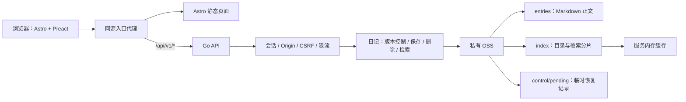

# 私密日记模块设计与实施说明

更新：2026-10-18。当前要求：单管理员、仅登录后可见、不提供草稿和发布快照，正文使用 Markdown 存储。之前的初始化报错已确认由残留环境变量覆盖配置文件导致，不是 RustFS 不可达或时区异常。

## 1. 范围与接入

现有 Astro 静态博客保留；`service/` 为独立 Go API，S3 兼容 OSS（当前为 RustFS）是唯一业务持久化存储，不引入数据库、Redis 或独立搜索服务。日记不会进入公开博客、RSS、sitemap、TinaCMS 或前端构建产物。

页脚小圆点链接进入 `/diary/`。隐藏入口只降低显著度，数据保护由接口鉴权执行。日记页面通过 Preact 动态请求同源 `/api/v1/`，使用查询参数切换列表、阅读、新建和编辑界面，兼容静态托管刷新。

| 地址 | 功能 |
| --- | --- |
| `/diary/` | 会话检查、登录、列表和检索 |
| `/diary/?view=new&id=<uuid>` | 新建，UUID 由浏览器生成 |
| `/diary/?view=read&id=<uuid>` | 查看当前已保存内容 |
| `/diary/?view=edit&id=<uuid>` | 编辑当前已保存内容 |

不提供注册、多用户、附件上传、自动保存、公开分享、历史版本界面、回收站界面。mTLS 当前仅保留 [需求说明](./diary-mtls-requirements.md)，另行实施。

## 2. 界面与操作

仅日记应用使用 Web Awesome 3.14.0；按需打包按钮、表单、标签页、确认弹窗、提示、标签及加载组件。主题选择器在构建时限制到 `.diary-app`，不引入全局 native reset，不替换公开博客及导航/页脚样式。主题随站点明暗设置同步；保留手机折叠筛选、底部保存及弹窗窄屏布局。

### 登录和退出

访问页面先请求 session；未登录只展示登录表单。登录成功显示列表，账号密码不写入 URL 或浏览器存储。退出在服务端撤销会话，前端清空正文和列表，并通过 BroadcastChannel 通知其他标签页。

会话失效后隐藏敏感内容；未保存输入仅暂存当前页面内存，重新登录后询问是否继续，重新获取服务器版本以检测冲突。刷新或关闭页面不持久保存这些输入。

### 新建和编辑

字段为标题、日记日期、标签和 Markdown 正文。仅保留一个“保存”按钮，`Ctrl/Cmd+S` 执行相同操作。保存即更新当前日记，不再有保存草稿、发布、更新发布、草稿状态筛选或版本切换标签。

- 日期默认 Asia/Shanghai 当天，允许补记，同一天可多篇。
- 标题去首尾空白后必填，最多 100 个 Unicode 字符。
- 正文非空，UTF-8 最多 256 KiB；请求体最多 1 MiB。
- 标签最多 10 个，每个 1–20 字符，去空白、去重并排序。
- 提交期间冻结表单，成功后更新已保存基线，失败保留输入。
- 显示未保存、保存中、保存时间和失败提示。
- 离开有修改的页面时提供保存后离开、放弃修改和继续编辑；关闭页面使用浏览器原生提示。
- 版本冲突返回 409，允许复制输入或载入最新版本，不能静默覆盖。
- 原操作结果未知时保留原 mutation ID，核对或重试同一操作；服务未就绪、尚未接受提交时允许稍后重新保存。

Markdown 渲染复用项目已有的 marked、DOMPurify。禁用原始 HTML、MDX 执行、iframe、危险协议链接和远程图片，HTML 输出使用允许列表清洗。

### 阅读、列表与删除

阅读页仅显示当前保存内容，提供编辑、删除。列表显示标题、日期、标签、摘要及更新时间，不显示草稿/发布状态。移动端单列，编辑与预览切换。

删除弹窗展示标题；确认后软删除，正常列表、阅读和检索立即不可见。服务端保留原 MD 内容和删除时间用于人工恢复，不生成另一份回收站文件，不提供恢复 UI 或自动物理清理。

空列表、检索无结果、参数错误、记录不存在及服务故障分别展示，不将读取失败伪装为空数据。

## 3. 检索

关键词防抖 300ms，回车立即检索；提供单标签精确过滤、日记日期区间和分页，不再有状态筛选。返回列表保留筛选与页码；旧请求取消并忽略过期响应。

关键词最多 100 字符，按空白拆分最多 10 个词，转小写后词间 AND；每个词在标题、标签或正文任一字段子串命中即可，中文无需分词。日期含首尾，各筛选条件取 AND。

排序：日记日期倒序、更新时间倒序、ID 升序。默认每页 20 条，最大 100，返回总数和最多 120 字符摘要，不下发完整索引或所有正文。

## 4. 架构与部署



Go 使用 net/http、AWS SDK for Go v2、Argon2id 和 YAML。单写入实例，全局写锁；停止旧实例后再启动新实例，不使用写入实例重叠的滚动更新。前端和 API 保持同源。

GitHub Pages 不能运行 Go。部署可由入口代理同时提供 Astro dist 和 Go API，也可以由已有网关代理静态站和 API，需验证 Host/SNI、证书和重定向。`service/Caddyfile.example` 是可选入口示例，不会随 Go/Compose 自动加载，也未配置 mTLS。

## 5. OSS 文件组织

```text
<S3_PREFIX>/
├── entries/<uuid>.md              # 一篇日记一个 MD 文件
├── index/catalog.json.gz          # 全站日记元数据目录
├── index/search/[0-f].json.gz      # 16 个正文检索分片
└── control/
    ├── pending.json               # 至多一笔操作的临时恢复记录
    └── probes/                    # 仅显式诊断/集成测试使用，测试后清理
```

MD 为内容事实来源，使用 YAML frontmatter 保存程序元数据：

```md
---
schemaVersion: 2
id: <uuid>
revision: 3
lastMutationId: <request-uuid>
requestHash: <request-hash>
title: 周末散记
diaryDate: "2026-10-17"
tags:
  - 生活
createdAt: 2026-10-17T08:00:00Z
updatedAt: 2026-10-17T09:00:00Z
---

今天散步，记录一些想法……
```

删除时增加 `deletedAt`，原文保留。正文不再是 JSON 字符串，不产生 `draft.md` 或 `published.md`。MD 响应类型为 `text/markdown; charset=utf-8`，支持 LF/CRLF frontmatter，保留正文原有内容和换行。

catalog schemaVersion 为 2，含 ID、版本、对象路径、最近操作标识及请求摘要、标题、日期、标签、摘要、创建/更新时间、内部 active/deleted 状态。删除项不保留标题、标签和摘要。内部删除状态不是草稿/发布状态。

search 按 UUID 第一个十六进制字符固定分为 16 片，含 ID、revision 和转小写正文，提供正文检索；这些是可重建的派生文本，不是另一份编辑版本。索引同样私密，不直接提供给浏览器。

### 一次保存涉及几个对象

| 对象 | 操作 | 是否长期存在 |
| --- | --- | --- |
| `control/pending.json` | 先写完整目标状态供恢复，最后删除 | 仅操作中或恢复未完成时存在 |
| `entries/<id>.md` | 写入本篇正文及 frontmatter | 是 |
| `index/catalog.json.gz` | 更新本篇元数据 | 是，全站共用 |
| `index/search/<分片>.json.gz` | 更新本篇所在分片 | 是，只改 16 片中的一片 |

普通保存是 **4 次 PUT + 1 次 DELETE**，另有必要读取及删除确认；成功后仅正文、目录和一个检索分片发生持久变化。不额外写草稿、定稿、历史副本、账号文件或会话文件。

首次空前缀初始化会生成 **1 个目录 + 16 个空检索分片，共 17 个长期对象**；目录先写 rebuilding、最后写 ready，因此该过程共 18 次 PUT，并非一次普通保存。第一次保存后，新增一篇 MD，总计 18 个长期对象。后续增加日记只新增各自 MD，目录和分片覆盖更新。S3 对象前缀不是必须预建的文件系统目录。

## 6. 一致性与恢复

写入在全局锁内执行：

1. 校验会话、请求及 expectedRevision，检查最近 mutation ID 重试。
2. 写 pending（完整目标、原版本、目标版本与校验摘要）。
3. 写 MD。
4. 写 catalog 和对应 search 分片。
5. 删除并确认 pending，切换内存缓存，返回成功。

OSS 没有跨对象事务，因此 pending 用于记录中途崩溃、超时或部分写入后的恢复目标；不应为减少一个文件而去掉它。接受操作之后的失败返回 WRITE_OUTCOME_UNKNOWN，后台重放至一致后开放接口。未接受请求、索引尚未就绪则返回 SERVICE_UNAVAILABLE，不能混为“已保存但结果未知”。

每次成功修改 revision 递增。相同最近 mutation ID、相同请求可识别重试，内容不同或版本不符返回 409。只保证最近操作的有限幂等，不保存永久操作历史。

恢复先读取 pending 和 catalog，核对目标、版本、摘要并完成剩余写入；遇到冲突不能静默覆盖。正常请求在提交期间等待锁，恢复未完成时拒绝日记操作。

## 7. 启动与旧格式兼容

正常启动只读取 pending 和 catalog，不逐篇读取正文；目录加载后列表即可使用。正文按篇读取，首个正文检索加载最多 16 个分片，之后复用缓存。索引缓存不写入本地业务数据文件。

目录缺失、损坏、schema 不兼容或处于 rebuilding 时才完整重建：标记 rebuilding → 分页枚举 entries → 读取并校验正文 → 写全部分片 → 最后发布 ready 目录。忽略 OSS 文件夹占位对象，异常文件名或损坏内容不能当作空数据。缺失/损坏分片被发现后进入维护恢复。

旧 JSON 日记兼容读取，以最新保存内容作为当前文档；读取优先 MD，同 ID 两种格式不重复列出。第一次修改旧日记时写入 MD，旧 JSON 保留备份，不自动删除。删除后的 MD 墓碑优先，避免旧 JSON 重现。旧格式完整 pending 通过摘要核对后可恢复为 MD；不删除未核对的恢复记录。

从旧版本升级会重建 schema 2 索引；必须停止旧写入实例再启动新版本。不要手工修改版本、操作标识等程序字段。人工编辑/导入 MD 时停服维护，合理递增 revision 和更新时间，然后执行 `--rebuild-index`；正常运行期间不绕过服务写 OSS。

## 8. API

统一 `/api/v1`；除登录和探针外要求会话，所有响应 no-store。接口不公开 OSS 路径或凭据。

| 方法与路径 | 行为 |
| --- | --- |
| POST `/auth/login` | 账号密码，返回会话信息及 CSRF token，设置 Cookie |
| GET `/auth/session` | 当前会话或 401 |
| POST `/auth/logout` | 撤销会话、清 Cookie |
| GET `/diaries` | q、tag、dateFrom、dateTo、page、pageSize；列表摘要及总数 |
| GET `/diaries/{id}` | 当前 document、revision 和时间 |
| PUT `/diaries/{id}` | expectedRevision、mutationId、document；新建 201，更新 200 |
| DELETE `/diaries/{id}` | expectedRevision、mutationId；软删除 |
| GET `/healthz` | 进程存活 |
| GET `/readyz` | 索引加载及恢复就绪状态 |

`document` 为 `{title,diaryDate,tags,contentMarkdown}`；没有 draft、published 或 action 字段，旧草稿请求会返回 400。

错误使用 code/message/requestId。主要状态：400 参数错误、401 未登录、403 Origin/CSRF 不通过、404 不存在、409 版本冲突、413 内容过大、429 限流、503 服务未就绪/操作结果待核对。

## 9. 配置、身份与运行

运行和容器配置以 [service/README.md](../service/README.md)、config.example.yaml、.env.example 为准。

- 配置优先级：非敏感默认值 < 显式 YAML 文件 < 已存在的环境变量。`--config` > DIARY_CONFIG；Go 不自动加载 dotenv。
- APP_ORIGIN 默认 `http://localhost:4321`，支持 HTTP/HTTPS；REQUIRE_HTTPS 默认 false，可开启 HTTPS origin 要求，实际 TLS 由入口代理配置。
- 管理员支持密码或 Argon2id 哈希，不能同层同时设置；环境密码表示整体替换文件密码表示。
- RustFS 未自定义 region 时为 us-east-1；endpoint 包含端口。桶私有，服务凭据授权目标前缀读取、写入、删除和枚举；网络链路依部署提供 HTTPS/加密隧道或可信内网。
- HTTPS Cookie 使用 Secure 和 `__Host-` 名称；HTTP 使用非 Secure 名称。均 HttpOnly、SameSite=Strict、Path=/，无 Domain。
- 32 字节随机 token，服务端内存只存 token 哈希，绝对有效期 12 小时；重启使会话失效。
- 所有变更校验 Origin 和会话绑定 CSRF token；登录校验 Origin 与 JSON 请求类型，不启用通配 CORS。
- 登录限流与哈希并发限制，入口补充限流；只信任明确配置的代理，当前服务忽略 X-Forwarded-For。
- 日志保留请求标识、路由、状态、耗时及安全错误码，不记录密码、token、正文、搜索词或原始 SDK 响应。启动显示环境覆盖的变量名，不显示值。
- 单实例，明确超时、大小限制与优雅退出。Dockerfile 多阶段构建，非 root 运行，不打包秘密；Compose 提供运行变量、只读配置挂载、健康检查和可选本地端口。
- 软删除和索引不能替代备份；桶版本/备份策略及恢复演练由实际部署落实，不自动清理历史数据。

## 10. 验证与交付边界

验收覆盖：登录/退出/会话失效、MD 保存和阅读、直接编辑生效、检索、删除、并发版本冲突、重复提交、各持久化边界失败后的恢复、旧 JSON/旧 pending 兼容、MD 换行和 frontmatter、恶意 Markdown、请求大小、配置覆盖与 HTTP/HTTPS Cookie。

Go 单元/协议测试、并发检测、类型检查、Astro 构建与浏览器流程用于本地验证；RustFS 集成测试使用随机隔离前缀，测试后清理，不操作现有业务数据。

当前不再继续排查已解决的初始化报错。后续需要核对一次操作时，以安全 reason 日志、pending 状态与上述写入顺序为依据，不直接删除对象。Docker 镜像运行、实际部署代理、备份策略和目标主机规模性能仍按环境验收；mTLS 独立实施。
