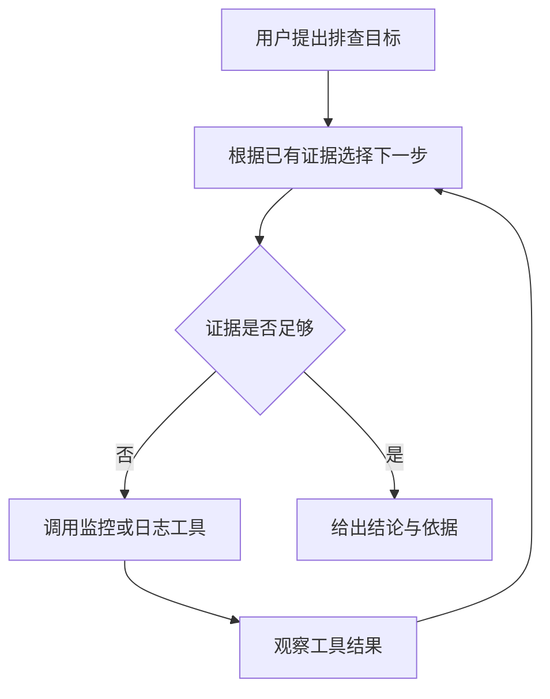
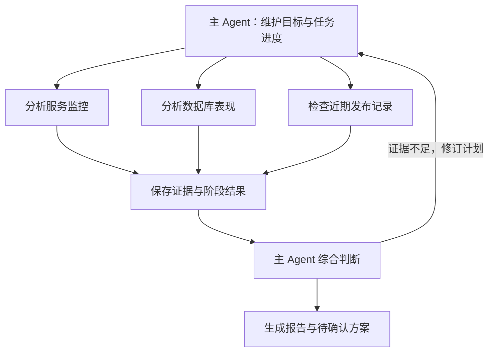
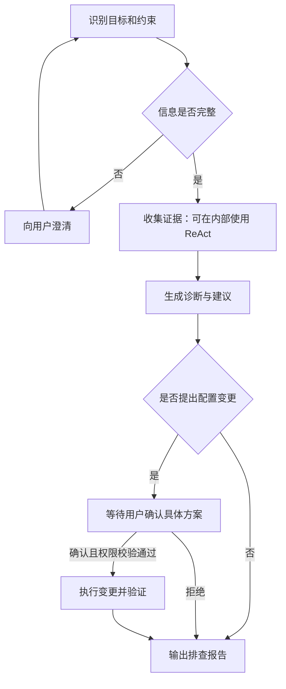
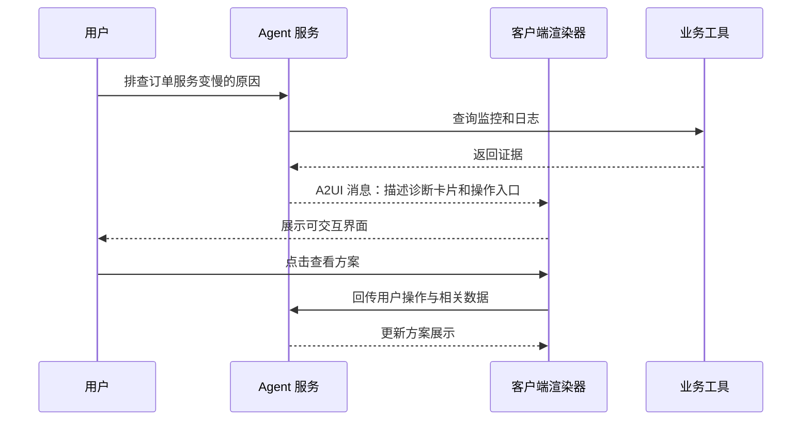
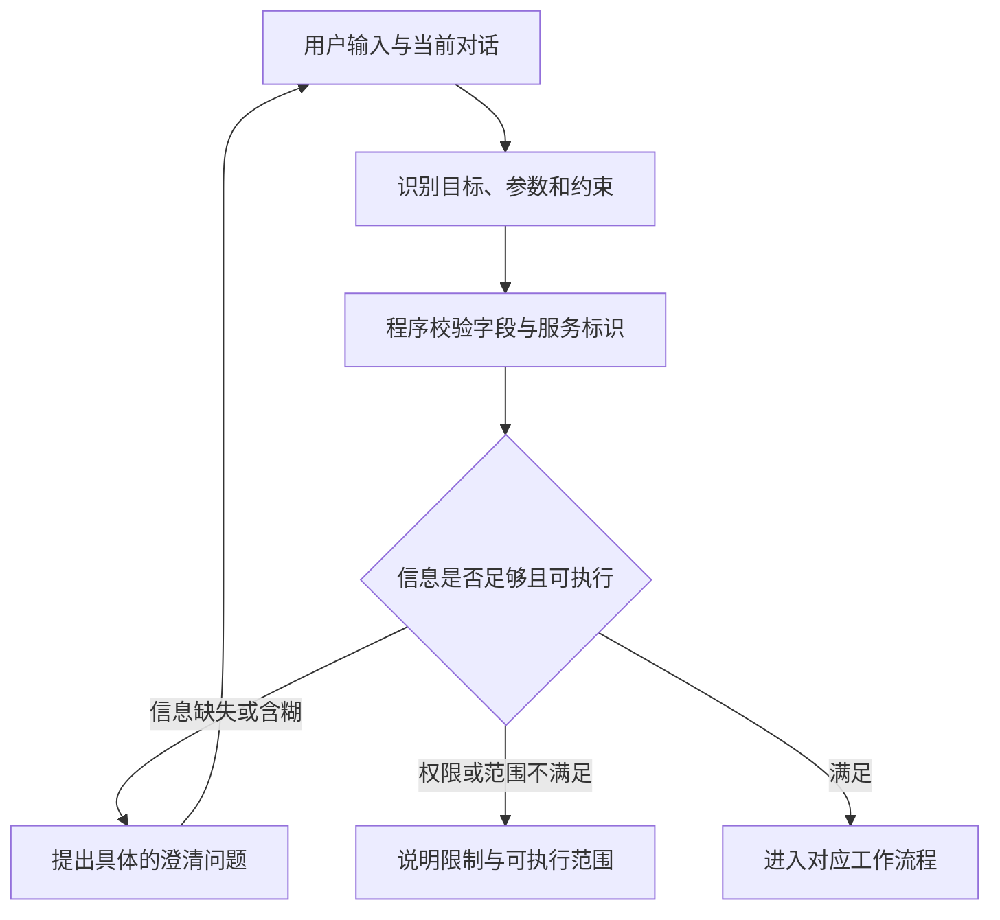
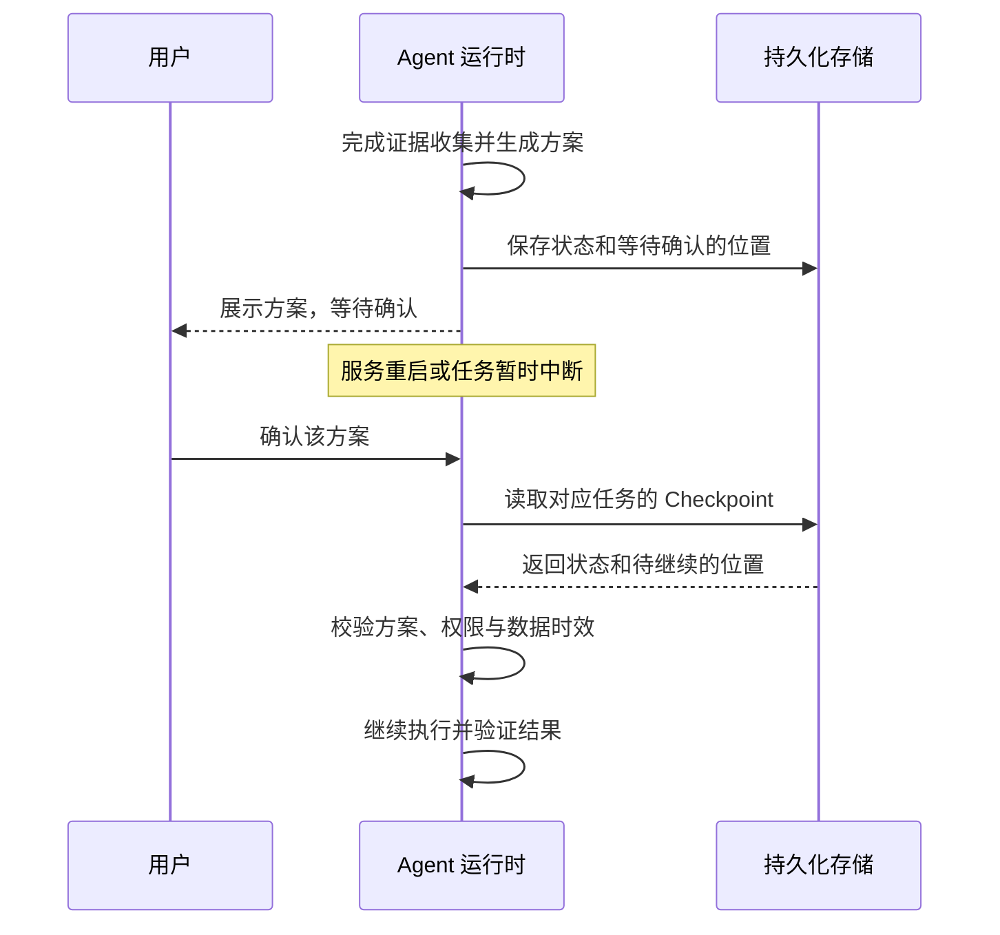

假设你对一个 AI 助手说：

> 帮我看看订单服务最近半小时为什么变慢了，给出处理建议，修改配置前先让我确认。

这句话背后有一串工作：确定服务和时间范围、查询监控、检索日志、比较证据、提出方案，还可能需要等待你的操作。把大模型接进聊天框，只解决了其中的语言交流部分。

**Agent 可以理解为：围绕目标，由模型和程序共同决定下一步，并通过工具获得反馈、持续推进任务的系统。** 模型负责理解与判断，运行程序负责调用工具、维护状态和约束执行。并非每个步骤都需要模型决定，也并非接入工具就能可靠完成任务。

下面围绕这个故障排查场景，看看原本分散的几个知识点怎样连接起来。

## Agent 模式

ReAct、DeepAgent、Graph 经常同时出现在 Agent 开发讨论中，但它们描述的侧重点不同。

| 概念 | 主要回答的问题 | 类比 |
| --- | --- | --- |
| ReAct | 怎样根据观察结果决定下一步行动？ | 排查问题时边查边调整判断 |
| DeepAgent | 怎样支撑步骤多、上下文长的复杂任务？ | 带着任务清单、资料库和助手的负责人 |
| Graph | 怎样明确组织步骤、分支和状态流转？ | 标出办理顺序和分支条件的流程图 |

它们可以组合：外层用 Graph 控制流程，某个节点内部使用 ReAct 循环，整个应用再增加 DeepAgent 常见的规划、文件管理和任务委派能力。

### ReAct：判断、行动、观察，再判断

ReAct 来自 Reasoning 与 Acting 的结合。核心做法是让推理判断和实际行动交替发生：根据已有信息选择行动，再把工具返回的观察结果作为后续判断的依据。原始方法见 [ReAct 项目与论文](https://react-lm.github.io/)。

对于“服务为什么变慢”，模型一开始并不知道真实原因。它可以先查延迟和错误率，再根据结果决定查数据库还是应用日志。



例如，一次简化的执行记录可能是：

```text
行动：查询订单服务最近半小时的延迟与错误率。
观察：延迟上升，错误率基本不变。

行动：查询数据库连接池的等待时间。
观察：连接等待明显增加。

行动：检查慢查询与数据库负载。
观察：发现一类查询耗时显著增加。

输出：把该查询列为重点怀疑对象，附上证据和进一步验证建议。
```

这里展示的是便于理解的行动摘要，不要求产品展示模型内部的完整推理过程。

ReAct 的价值在于能利用新证据调整方向。不过，工具结果也可能缺失、过期或出错，循环本身并不保证结论正确。开发时还要设置步数、超时和调用成本上限；连续查不到新证据时，应报告不确定性或请求补充信息。

### DeepAgent：为复杂任务增加工作配套

这里的 DeepAgent 指面向复杂任务的一类 Agent 设计思路；具体实现可以参考 LangChain 的 [Deep Agents](https://docs.langchain.com/oss/python/deepagents/overview)。它不是一种新的模型，也不是与 ReAct 互斥的统一算法。

当任务变成“排查多个服务、比较近期发布、整理报告并提出验证方案”时，单靠越来越长的聊天记录，容易丢失任务进度和重要证据。常见的配套能力包括：

* **任务规划**：把大目标拆成可检查的步骤，根据结果修订计划。
* **文件与上下文管理**：把长日志、分析结果存入文件，需要时再读取，减少上下文拥挤。
* **任务委派**：把边界清楚的子任务交给专门的 Agent，返回相关证据与摘要。
* **人工介入**：在需要授权或业务判断的位置暂停，等待输入。



图中的分工既可以由工具和普通程序完成，也可以按需要使用子 Agent。子 Agent 应拿到完成任务所需的上下文和明确的返回要求，例如“检查数据库连接等待，返回时间范围、查询依据与结论”。任务委派会增加调用成本和协调成本，小任务没有必要刻意拆成多个 Agent。

另外，**写入文件不等于获得长期记忆**。如果文件只存在内存或临时容器里，重启后仍然可能消失；能否跨会话保留，取决于存储后端与读取机制。

### Graph：把执行路径变成明确的状态流转

Graph 是图式编排方式。开发者把工作拆成节点，用边连接执行顺序，再根据状态决定走哪条分支。

* **节点（Node）**：完成一项工作，例如识别意图、查询监控或生成方案。
* **边（Edge）**：指定节点之间的流转关系，可以包含条件分支和循环。
* **状态（State）**：在步骤间传递的数据，例如目标服务、证据列表、当前方案和确认结果。



Graph 让关键路径更明确：模型可以判断应该查什么，但“配置变更前必须确认”可以由程序控制。Graph 也可以用于完全确定的工作流，只有在部分节点引入模型自主决策时，才体现出 Agent 行为。

选型时，可以先从简单的工具调用循环开始；当分支、人工等待和恢复要求变复杂时，再引入显式流程编排。长任务需要的上下文管理和委派能力，则按实际困难逐步补上。

## A2UI（Agent to UI）消息

诊断结束后，用户可能需要查看证据卡片、填写参数或确认方案。纯文字聊天能表达这些内容，但结构化界面更方便比较与操作。

[A2UI 官方项目](https://a2ui.org/)提供了一种声明式界面协议：Agent 发送描述界面结构与数据的消息，客户端用预先支持的组件渲染出界面。可以把它理解成“Agent 给前端一份界面说明书”。

例如，Agent 想展示“数据库连接等待增加”的诊断卡片，可以描述卡片标题、证据文本和“查看详情”按钮；前端负责把它们渲染成网站或移动端中的实际组件。



理解 A2UI，可以先抓住三个要素：

| 要素 | 含义 | 场景中的例子 |
| --- | --- | --- |
| 界面结构 | 展示哪些组件以及组件关系 | 一张包含标题、证据和按钮的卡片 |
| 界面数据 | 组件绑定或展示的内容 | 服务名、时间范围、诊断结果 |
| 用户操作 | 用户在界面上做了什么 | 查看详情、提交参数、确认方案 |

协议字段随版本演进，接入时应让服务端消息与客户端渲染器使用兼容的版本，并按对应 schema 校验。科普层面先理解结构、数据和操作的关系，比记忆某一版字段更有帮助。

A2UI 负责界面表达，业务执行仍由后端负责。例如，点击“确认变更”后，后端还需要核对身份、权限、方案版本和参数。消息使用声明式格式，可以减少直接执行生成代码的需要，但不能替代业务授权。

## 意图识别

意图识别回答的是：**用户想完成什么，以及执行前还缺少哪些信息。**

传统系统可能把输入分类为“查订单”“退款”或“投诉”。Agent 应用通常还要提取参数、约束和执行范围。

回到开头的请求，可以整理成以下结构。这里是业务数据示意，不是某个框架的固定协议：

```json
{
  "intent": "diagnose_service_latency",
  "service": "order-service",
  "time_range": "最近半小时",
  "deliverables": ["原因分析", "处理建议"],
  "constraints": {
    "require_confirmation_before_config_change": true
  },
  "missing_fields": []
}
```

真实执行前，还要结合请求时间与时区，把“最近半小时”转换成明确的起止时间；再把“订单服务”匹配到用户有权访问的服务标识。

意图识别可以由规则、分类模型或大模型完成，也可以组合使用。常见处理过程是：先理解目标，提取参数，再用程序做格式、实体和权限校验；缺少必要信息时，才进入澄清分支。



例如，用户只说“帮我处理一下”，系统需要结合上下文判断“处理”是继续排查、生成方案，还是执行刚才的方案。如果存在多种合理解释，就应问清楚具体动作。

这里要区分两件事：识别出“用户可能想修改配置”，并不意味着已经获得修改授权。尤其当用户提前说了“修改前让我确认”，这个约束应当进入状态，并在执行位置由程序检查。

也不要把模型自己给出的“置信度 0.95”直接当成可靠概率。是否需要澄清，更应该结合必要参数是否完整、候选意图是否冲突，以及误执行的后果判断。

## Checkpoint

Checkpoint 可以类比游戏存档：把任务运行到某个位置时的状态保存下来，后续有机会从相应位置继续。

例如，Agent 已经花了几分钟收集证据并生成方案，此时需要等你确认。如果服务重启后只能重新读取聊天记录，它未必能准确知道流程停在哪里。Checkpoint 则可以记录已收集的证据、待确认的方案以及下一步执行位置。

以 [LangGraph 的持久化机制](https://docs.langchain.com/oss/python/langgraph/persistence)为例，checkpointer 保存一个 thread 范围内的图状态，用于会话连续性、中断恢复等场景；跨 thread 的长期信息则可由独立的 store 保存。



一个简化的业务状态可能长这样，实际框架的存储结构会更复杂：

```json
{
  "thread_id": "diagnosis-001",
  "stage": "waiting_for_confirmation",
  "service": "order-service",
  "evidence_refs": ["metrics-result-01", "logs-result-02"],
  "proposal_id": "proposal-003",
  "proposal_version": 1,
  "confirmed": false
}
```

任务标识用于找到这次执行；证据引用帮助恢复上下文；方案标识与版本把用户的确认绑定到具体内容。等待时间较长时，恢复后还需要检查原来的证据和方案是否仍然适用。

### Checkpoint、聊天记录、长期记忆有什么不同？

| 类型 | 主要保存什么 | 主要用途 |
| --- | --- | --- |
| 聊天记录 | 用户和助手的消息 | 回看对话、提供语言上下文 |
| Checkpoint | 执行状态，以及恢复执行所需的信息 | 知道这次任务做到哪里、怎样继续 |
| 长期记忆 | 有选择保留的偏好、事实与经验 | 为后续任务提供跨会话信息 |

聊天消息也可以是 Checkpoint 状态的一部分。区别在于，单独保存消息通常不足以恢复程序的执行进度。另外，使用内存 checkpointer 时，进程退出后存档仍会消失；需要跨重启恢复，就要配置持久化存储。

### 存档不等于外部操作可以回滚

假设工具已经修改了配置，但程序还没保存“修改成功”的状态就崩溃。恢复后如果再次调用工具，就可能重复执行。

因此，对于有外部副作用的工具，还要设计幂等键、操作记录和结果核对机制。即使任务状态恢复到了修改之前，外部配置也不会自动回到原值；需要撤销时，仍然要通过明确的回滚或补偿操作实现。

Checkpoint 提供恢复执行的基础，可靠性还取决于存储方式、工具设计和恢复时的校验。

## 把这些概念放回同一个应用

对于开头的排障助手，可以这样理解各部分的分工：

1. **意图识别**确定排查目标，提取服务、时间范围和“修改前确认”的约束。
2. **Graph**组织查询、诊断、等待确认和执行验证的路径。
3. **ReAct**在收集证据时，根据工具反馈调整下一步查询。
4. **DeepAgent 常见能力**帮助较长任务管理计划、文件和分工。
5. **A2UI**把诊断与方案组织成用户可以查看、填写和操作的界面。
6. **Checkpoint**记录执行进度，让等待和中断之后的任务能够继续。

开发时最值得先明确的是：什么算完成、证据怎样核验、哪些动作可以自动执行、哪些位置必须等待用户，以及中断后怎样继续。把这些边界设计清楚，再选择框架，才容易得到一个可理解、可验证的 Agent 应用。

## 参考资料

* [ReAct：项目介绍与原始论文](https://react-lm.github.io/)
* [Deep Agents：能力与设计概览](https://docs.langchain.com/oss/python/deepagents/overview)
* [A2UI：协议介绍与交互流程](https://a2ui.org/)
* [LangGraph：持久化、Checkpointer 与 Store](https://docs.langchain.com/oss/python/langgraph/persistence)
