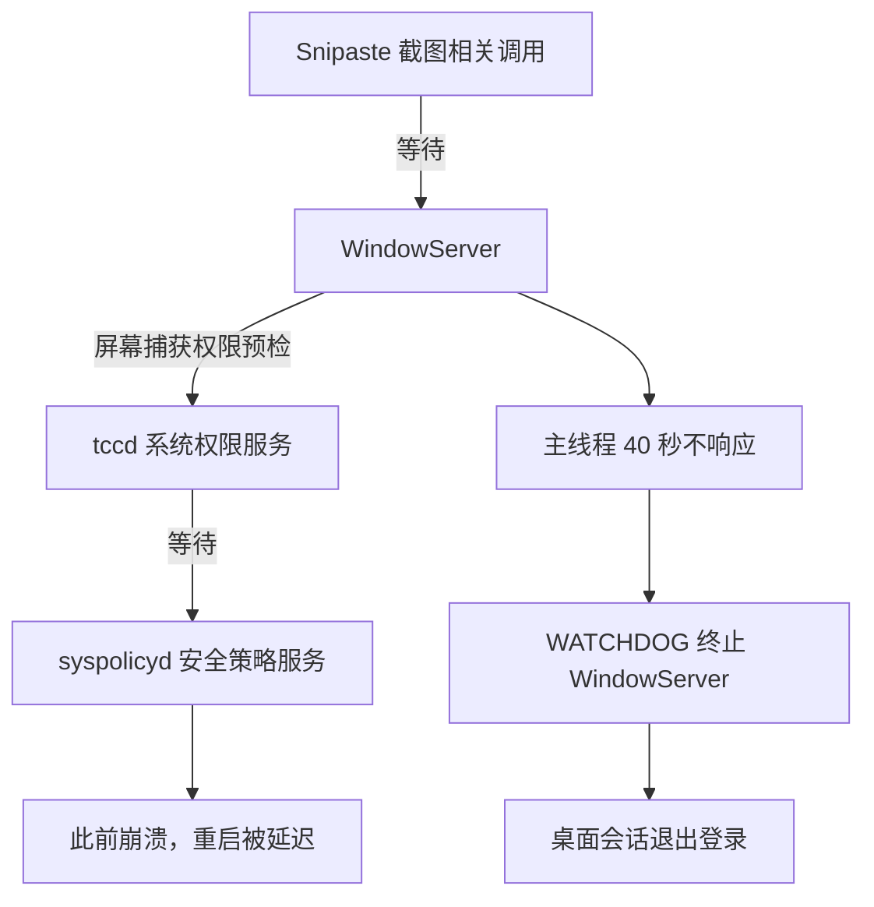

连续两天，Mac 出现了三次相似故障：界面突然停滞，随后所有窗口消失，回到登录界面。第三次发生在使用 Snipaste 准备截图时，很容易让人直接怀疑截图软件。

排查最终推进到了更上游：**系统安全策略服务 `syspolicyd` 在处理 Go 临时测试程序的签名时发生异常，截图权限检查等待这个已经不可用的服务，最终让桌面进程超时退出。**

其中，“桌面为什么退出”和“安全服务当时在处理哪个测试程序”已经有直接日志依据；“临时文件的清理与签名形成竞争”仍属于高度吻合的机制推断，缺少文件删除事件和隔离复现，不能当成完全证实的最终根因。

本文记录实际排查过程、使用的命令，以及每一步结论的证据边界。时间均为北京时间 UTC+8；公开的日志片段省略了用户名和部分临时目录前缀，PID、线程号、时间和关键路径标记保留原值。

## 1. 故障现象和环境

| 项目 | 现场情况 |
| --- | --- |
| 硬件 | Apple Silicon MacBook Pro，32 GB 内存 |
| 系统 | macOS 15.6.1，Build 24G90 |
| Snipaste | 2.10.8，本次崩溃报告为 ARM-64，`translated: false` |
| Go | `/usr/local/go/bin/go` 为 x86_64，VERSION 文件记录 go1.27.1 |
| 系统 Security 组件 | 61439.140.12 |
| 三次桌面会话退出 | 10 月 19 日 14:48:29、15:58:40；10 月 20 日 10:58:50 |

第三次故障前，用户正在使用 Snipaste 截图。但排查时必须分别回答：

1. 是整个系统重新启动，还是只有图形登录会话退出？
2. Snipaste 是最先出错的进程，还是在等待系统服务？
3. 安全服务崩溃时，正在处理哪个文件？
4. 是资源耗尽、架构兼容问题，还是系统签名处理的异常路径？

## 2. 先确认是重启还是桌面会话退出

最先检查时间、登录记录与最近生成的诊断报告：

```bash
date '+%Y-%m-%d %H:%M:%S %Z'
uptime
last -15
last reboot shutdown | head -15

ls -lt /Library/Logs/DiagnosticReports | head -25
ls -lt "$HOME/Library/Logs/DiagnosticReports" | head -15
```

现场最近一次整机启动仍是 10 月 17 日，而 `console` 登录记录在故障后重新建立。进一步查看系统会话日志：

```bash
rg 'Oct 20 10:(58|59):' /var/log/system.log
```

关键记录：

```text
10:58:50 sessionlogoutd: DEAD_PROCESS: 4162 console
10:59:14 loginwindow: USER_PROCESS: 99782 console
```

这与“原桌面会话结束，然后重新登录”吻合。结合后面 WindowServer 的终止报告，可以把本次现象判断为图形会话退出，而不是整机重启。

这里不能只看用户说的“卡掉了”：锁屏、普通应用崩溃、WindowServer 重启、系统重启，排查入口完全不同。

## 3. 从 WindowServer 报告找到直接原因

故障时段生成了两类关键文件：

```text
WindowServer-2026-10-20-105850.ips
WindowServer_2026-10-20-105853_*.userspace_watchdog_timeout.spin
```

`.ips` 的报告时间是 10:58:50；`.spin` 文件名中的生成时间不能直接当作卡死开始时间。它内部记录的实际采样时间是 10:58:40—46。

先从文本堆栈读取报告原因和等待链：

```bash
report='/Library/Logs/DiagnosticReports/WindowServer_2026-10-20-105853_zdeMacBook-Pro.userspace_watchdog_timeout.spin'

head -90 "$report"
rg -n 'blocked by turnstile|kTCCServiceScreenCapture|throttled after SIGSEGV' "$report"
```

报告明确写道：

```text
WindowServer main thread
40 seconds since last successful checkin
```

`.ips` 中的终止信息则是：

```text
namespace: WATCHDOG
indicator: monitoring timed out for service
```

这确认了直接原因：**WindowServer 主线程长时间不响应，被系统看门狗终止。**

### 3.1 不能停在“WindowServer 崩了”

继续查看主线程堆栈，它位于：

```text
com.apple.tcc.auth.preflight.kTCCServiceScreenCapture
```

也就是屏幕捕获权限预检路径。等待信息指向系统级权限服务 `tccd [392]`，而该服务又在等待 `com.apple.security.syspolicy`。

与此同时，Snipaste 的主线程明确等待 WindowServer。把几段堆栈接起来，是这样的阻塞关系：



这张图表达的是日志中的等待关系。最底层服务为什么崩溃，还需要继续向前查。

## 4. 用事发快照核对资源，避免被虚拟内存数字误导

恢复登录后，可以检查当前状态：

```bash
vm_stat
memory_pressure
df -h /
```

但当前状态不能直接代表故障当时，所以更有价值的是 WindowServer 报告中的 `postSampleVMStats`。

本次 `.ips` 文件第一行是 JSON 元数据，后面是报告正文 JSON。可以用下面的方式读取：

```bash
python3 - /Library/Logs/DiagnosticReports/WindowServer-2026-10-20-105850.ips <<'PY'
import json
import sys
from pathlib import Path

report = json.loads(Path(sys.argv[1]).read_text().split('\n', 1)[1])
print('captureTime:', report.get('captureTime'))
print('termination:', report.get('termination'))
print('thermalPressureLevel:', report.get('thermalPressureLevel'))

vm = report.get('stackshot', {}).get('postSampleVMStats', {})
page_size = 16384  # 本机报告中的 VM page size，不应直接套用到其他机器
print('VM:', vm)
print('free GiB:', vm.get('free_count', 0) * page_size / 1024**3)
PY
```

第三次故障快照中：

| 指标 | 记录 |
| --- | --- |
| 空闲页 | 344574 页，按每页 16384 字节计算，约 5.26 GiB |
| swapins / swapouts | 均为 0 |
| 温度压力 | Nominal |
| Snipaste footprint | 约 202.91 MB |
| Snipaste 采样期 CPU 时间 | 5.57 秒内不足 0.001 秒 |

这些记录支持“线程在等待服务”的解释，没有提供内存耗尽或过热的证据。但它们是采样快照，不能证明整个故障时段从未出现过资源压力。

之前的 Go 测试报告还出现过：

```text
REGION TYPE             VIRTUAL SIZE
mapped file             9.2G
```

这里的 9.2G 属于**虚拟地址空间映射**，不能直接解释成测试实际消耗了 9.2 GB 物理内存。

## 5. 安全服务为什么没有及时恢复

查看 `syspolicyd` 的崩溃报告，栈顶重复出现：

```text
Security::Universal::architecture() const
Security::CodeSigning::MachORep::signingData()
Security::CodeSigning::MachORep::component(unsigned int)
...
SecStaticCodeCheckValidityWithErrors
```

异常类型为：

```text
EXC_BAD_ACCESS / SIGSEGV
KERN_INVALID_ADDRESS at 0x8
```

10:40:40 的报告记录 `consecutiveCrashCount: 25`、`throttleTimeout: 1200`。具体重启延迟还要看 launchd 日志：

```bash
rg '2026-10-20 10:(39|40|58|59):.*com.apple.security.syspolicy' \
  /var/log/com.apple.xpc.launchd/launchd.log*
```

得到的关键顺序是：

```text
10:39:53.737  syspolicy 开始启动
10:40:40.845  Service only ran for 47 seconds.
             Pushing respawn out by 1153 seconds.
10:40:40.845  service spawn deferred by 1153 seconds due to throttle
10:59:53.820  syspolicy 再次启动
```

桌面在 10:58:50 退出时，正处于这段服务重启延迟期间。这样就能解释：为什么安全服务在十八分钟前已经崩溃，却在后来截图时才表现为整个桌面卡住。

## 6. 早期线索：x86 Go 测试与安全服务崩溃时间接近

对工具链做静态检查：

```bash
command -v go
file /usr/local/go/bin/go
cat /usr/local/go/VERSION
```

现场结果是 x86_64 Go。这里没有通过运行这个 Go 来检查架构。

Rosetta 是 Apple Silicon 上运行 Intel 程序的兼容转换工具。此前两份 `marketing.test` 报告均为：

```text
cpuType: X86-64
translated: true
thread count: 1
```

它们都在启动约 120 秒后收到父进程 `go` 发出的 `SIGQUIT`。这与超时终止相吻合，不能当成测试发生 OOM 的证据；仅一个线程的快照也不足以证明此前绝对没有运行过业务代码。

多批测试启动与 `syspolicyd` 崩溃的时间接近，最初因此把 x86／Rosetta 测试列为重点方向。但这一步仍只是时间关联，不能直接回答“服务究竟在检查哪个文件”。

10 月 20 日的 `clinic_material_generation.test` 也曾被列为候选对象。后面的统一日志提供了更直接的目标信息，调查因此修正了这个早期推测。

## 7. 从统一日志里追查被检查的文件

### 7.1 正常终端中的查询方式

在具备日志访问权限的普通终端里，可以按服务和时间范围读取日志：

```bash
/usr/bin/log show \
  --start '2026-10-20 10:39:40' \
  --end '2026-10-20 10:40:42' \
  --style compact \
  --info --debug \
  --predicate 'process == "syspolicyd" OR process == "tccd" OR process == "kernel"'
```

如果需要在日志轮转前保留现场，可以在有相应权限的终端导出日志归档：

```bash
sudo /usr/bin/log collect \
  --last 2h \
  --output "$PWD/syspolicyd-incident.logarchive"
```

这是供后续现场采集使用的命令，本次没有执行这条 `sudo` 导出命令。统一日志归档可能包含其他应用的信息，分析和分享时需要缩小范围、脱敏。

本次实际环境里，系统 `log` 命令返回：

```text
log: Cannot run while sandboxed
```

但原始日志文件可以读取，因此改用离线解析方式。

### 7.2 原始文件和辅助字典

本次读取的文件包括：

```text
/var/db/diagnostics/Persist/*.tracev3
/var/db/diagnostics/timesync/*.timesync
/var/db/uuidtext/<两位十六进制目录>/...
/var/db/uuidtext/dsc/...
```

`tracev3` 不是可以直接 `grep` 的普通文本。只读取单个 tracev3 文件时，解析结果曾出现：

```text
Unknown shared string message
1970-01-01T...
```

补齐 `uuidtext`、`dsc` 与 `timesync` 后，才能还原消息模板、进程信息和墙上时钟时间。缺少这些辅助数据的输出不能拿来建立准确故障时间线。

### 7.3 使用原生 ARM64 离线解析器

本次使用 [Mandiant macos-UnifiedLogs v0.7.0](https://github.com/mandiant/macos-UnifiedLogs/releases/tag/v0.7.0) 的官方 ARM64 发布件。下载后先校验散列和架构，再执行：

```bash
mkdir -p parser
curl --fail --location \
  --output parser/parser.tar.gz \
  'https://github.com/mandiant/macos-UnifiedLogs/releases/download/v0.7.0/unifiedlog_iterator-v0.7.0-aarch64-apple-darwin.tar.gz'

shasum -a 256 parser/parser.tar.gz
```

该版本现场核对的压缩包 SHA256 为：

```text
bf5c4a3418b133fbd403ca7893a2280acb8c2c3605b4ad6f87f9fc75b35a20b7
```

只有结果一致，才继续解压：

```bash
tar -xzf parser/parser.tar.gz -C parser
file parser/unifiedlog_iterator-v0.7.0-aarch64-apple-darwin/unifiedlog_iterator
```

`file` 应确认可执行文件为 `arm64`。不要下载 x86 版本后用 Rosetta 来做本次调查。

下面演示如何组装只包含两个目标 tracev3 文件的离线目录。文件编号是本次现场值，其他机器或其他时间需要重新选择；文件修改时间只能辅助选择候选文件，最终事件时间以解码后的记录为准。

```bash
export INCIDENT_ARCHIVE="$PWD/incident.logarchive"

python3 <<'PY'
import os
import shutil
from pathlib import Path

archive = Path(os.environ['INCIDENT_ARCHIVE'])
(archive / 'Persist').mkdir(parents=True, exist_ok=True)

for name in ['00000000000023db.tracev3', '00000000000023dc.tracev3']:
    source = Path('/var/db/diagnostics/Persist') / name
    shutil.copy2(source, archive / 'Persist' / name)

shutil.copytree(
    '/var/db/diagnostics/timesync', archive / 'timesync',
    dirs_exist_ok=True,
)
# 日志归档格式中，uuidtext 的十六进制目录和 dsc 放在根目录下。
for source in Path('/var/db/uuidtext').iterdir():
    if source.is_dir():
        shutil.copytree(source, archive / source.name, dirs_exist_ok=True)
PY
```

本次工作副本对字典使用了本机路径引用；上面的示例改为复制字典，便于长期保留和独立复核。复制字典需要一定磁盘空间；遇到权限拒绝时应申请相应读取权限。

执行解析：

```bash
parser/unifiedlog_iterator-v0.7.0-aarch64-apple-darwin/unifiedlog_iterator \
  --mode log-archive \
  --input "$INCIDENT_ARCHIVE" \
  --output "$PWD/decoded.jsonl" \
  --bookmark-path "$PWD/parser-bookmark.json"
```

输出可能很大，后续按 PID 和时间流式筛选，避免一次性全部载入内存。原始文件可以同时生成校验清单：

```bash
shasum -a 256 "$INCIDENT_ARCHIVE"/Persist/*.tracev3 > tracev3.sha256
```

## 8. 关键突破：用线程号和 TCC attribution 关联目标文件

### 8.1 先从崩溃报告取出真正崩溃的线程

```bash
python3 - /Library/Logs/DiagnosticReports/syspolicyd-2026-10-20-104040.ips <<'PY'
import json
import sys
from pathlib import Path

report = json.loads(Path(sys.argv[1]).read_text().split('\n', 1)[1])
thread = report['threads'][report['faultingThread']]
print('PID:', report['pid'])
print('thread ID:', thread['id'])
print('x0:', thread['threadState']['x'][0])
print('fault address:', thread['threadState']['far'])
for frame in thread['frames'][:12]:
    print(frame.get('symbol', '<未符号化>'))
PY
```

10:40 这次的关键值：

```text
syspolicyd PID: 96610
faulting thread ID: 12733102
x0: 0
fault address: 8
```

不能只取安全服务最后一条日志：一个进程内有多个并发线程，最后一条消息可能属于其他任务。应回到崩溃线程本身。

### 8.2 从 JSONL 筛选安全服务、目标 PID 和权限归属

解析器使用 UTC 时间，所以北京时间 10:40 对应输出中的 `02:40Z`。以下示例适用于本次工具版本的输出字段：

```bash
python3 - decoded.jsonl > target-events.jsonl <<'PY'
import json
import sys

with open(sys.argv[1]) as stream:
    for line in stream:
        row = json.loads(line)
        timestamp = row.get('timestamp', '')
        if not ('2026-10-20T02:40:38' <= timestamp < '2026-10-20T02:40:42'):
            continue
        message = row.get('message', '')
        relevant = (
            row.get('pid') == 96610
            or '97575' in message
            or '4ea6a97163520e44' in message
        )
        if relevant:
            print(json.dumps(row, ensure_ascii=False))
PY
```

第一条目标线索是安全服务的扫描记录：

```text
10:40:38.939  PID=96610
GK performScan: PST: (path: 4ea6a97163520e44), ...
```

这里的 `path` 是日志中的路径标记，并没有直接给出原路径。随后 `tccd` 的权限归属记录补上了文件名：

```text
10:40:40.001899
AUTHREQ_ATTRIBUTION: msgID=96610.1
accessing:
  pid=97575
  binary_path=<TMP>/go-build2744517975/b001/clinic_case_recommendation.test
requesting:
  identifier=com.apple.syspolicyd
  pid=96610
```

`<TMP>` 对应本机 `/private/var/folders/.../T`，仅做了目录前缀脱敏。

紧接着，provenance 记录关联了扫描目标与 PID 97575；内核日志也明确写出：

```text
Sandbox: clinic_case_recommendation.test(97575) deny(1) ...
```

**这里没有破解路径哈希，而是利用目标处理记录、TCC attribution、PID 和紧邻时间，把文件关联起来。** provenance 标记本身也不应被当作唯一文件标识，必须结合整段上下文。

### 8.3 同一个崩溃线程出现签名错误

回到线程 `12733102`：

```text
10:40:40.091646  BE adhoc signing PST: (path: 4ea6a97163520e44), ...
10:40:40.200602  BE adhoc signing PST: (path: 4ea6a97163520e44), ...
10:40:40.324771  UNIX error exception: 2
10:40:40.324886  Unable to add signer to code reference. 100002
10:40:40.326497  Error checking with notarization daemon: 3
10:40:40.341     syspolicyd 崩溃
```

这把证据从“测试启动时间接近”推进到了：**安全服务正在处理该测试目标的临时签名；同一线程在签名出错后，进入了崩溃栈中的校验路径。**

## 9. 再查一次，确认不是偶然碰到同名进程

10:20:19 的另一份崩溃报告中：

| 项目 | 记录 |
| --- | --- |
| syspolicyd PID | 92912 |
| 崩溃线程 | 12713809 |
| 扫描路径标记 | 563b1855c912e642 |
| 关联目标进程 | 94207 |
| 内核记录的目标名 | clinic_case_recommendation.test |
| 崩溃寄存器 | x0=0，访问地址 0x8 |

该线程也依次记录：

```text
BE adhoc signing PST
UNIX error exception: 2
Unable to add signer to code reference
Failed to generate SecStaticCode
Unable to set callback for adhoc signature creation
```

随后在同样的 `Universal::architecture()` → `MachORep::signingData()` 路径崩溃。

因此，**目前直接关联出的目标是 `clinic_case_recommendation.test`**。此前根据时间接近而怀疑 `clinic_material_generation.test`，属于调查早期线索，应随着新证据修正。

## 10. 对照苹果同版本源码，解释空指针从哪里来

崩溃报告中 Security 的组件版本为 `61439.140.12`。苹果公开仓库提供了[对应版本源码](https://github.com/apple-oss-distributions/Security/tree/Security-61439.140.12)，因此可以核对实际报错路径，而不只根据函数名猜测。

### 10.1 刷新缓存时，先清空对象再重建

[MachORep::flush()](https://github.com/apple-oss-distributions/Security/blob/Security-61439.140.12/OSX/libsecurity_codesigning/lib/machorep.cpp#L405) 的关键顺序是：

```cpp
delete mExecutable;
mExecutable = NULL;
// 清理其他缓存并关闭旧文件句柄
SingleDiskRep::flush();
mExecutable = new Universal(fd(), offset, length);
```

[SingleDiskRep::fd()](https://github.com/apple-oss-distributions/Security/blob/Security-61439.140.12/OSX/libsecurity_codesigning/lib/singlediskrep.cpp#L96) 会在需要时按原路径重新打开文件。

也就是说，在重建成功之前，`mExecutable` 处于空状态。如果重新打开文件失败并抛出异常，这个对象可能来不及恢复。

### 10.2 后续签名读取会直接调用对象方法

[MachORep::signingData()](https://github.com/apple-oss-distributions/Security/blob/Security-61439.140.12/OSX/libsecurity_codesigning/lib/machorep.cpp#L329) 中存在：

```cpp
mainExecutableImage()->architecture()
```

该调用处没有先检查返回对象是否为空。[Universal::architecture()](https://github.com/apple-oss-distributions/Security/blob/Security-61439.140.12/OSX/libsecurity_utilities/lib/macho%2B%2B.cpp#L707) 又需要读取对象自身的状态。

结合两次报告中 `x0=0`、访问地址 `0x8`，以及紧邻的签名失败日志，最符合现场的解释是：

```text
临时测试文件进入签名处理
    ↓
签名或文件重新访问失败
    ↓
缓存刷新／异常恢复留下空对象
    ↓
后续静态签名校验再次使用该引用
    ↓
空指针访问，syspolicyd 崩溃
```

**这是一条由同版本源码、日志、寄存器共同支持的机制推断。** 尚未取得文件删除审计、当时对象堆内存和完整异常恢复调用轨迹，不能说每个中间步骤都已被动态验证。

### 10.3 为什么还不能直接说“Go 删除了文件”

目标位于 Go 临时构建目录，事后也已经不存在。日志中的 UNIX 错误码 2 对应文件不存在，因此“临时文件清理与异步签名发生竞争”值得重点验证。

但它仍存在证据缺口：

- 没有当时 `unlink`、`rename` 或目录清理事件。
- 通用错误码没有逐条附上失败的目标路径。
- 无法确认文件由 Go、测试脚本还是其他进程移除。
- 事后文件不存在，并不能倒推出精确删除时刻。

日志还出现了 `/private/var/db/DetachedSignatures` 不存在的消息。它不能简单与后面的通用错误码 2 合并，更不能据此断言系统签名数据库损坏。

## 11. Snipaste 在这条链中的位置

第三次故障的时间线是：

| 时间 | 事件 |
| --- | --- |
| 10:40:40 | syspolicyd 先崩溃，重启被延迟 |
| 10:58:40—46 | Snipaste 等待 WindowServer；WindowServer 等待权限服务 |
| 10:58:50 | WindowServer 超时，桌面会话结束 |
| 10:58:56 | Snipaste 自身发生 SIGSEGV |
| 10:59:14 | 新登录会话建立 |
| 10:59:53 | syspolicy 重新启动 |

Snipaste 自身崩溃的栈顶是 `CF_IS_OBJC`、`CFArrayGetCount`，访问地址为 0。它发生在 WindowServer 被终止之后约 5.5 秒，不能拿来证明“Snipaste 先崩溃，带掉整个桌面”。

它可能存在系统服务退出后的错误处理问题，也可能有独立缺陷，现有应用栈未完全符号化，暂不定论。此前本地 `codesign --verify` 还返回过 Snipaste 签名无效，这也是独立待查项，不能自动提升为本次系统故障的起因。

此外，Snipaste 此次报告明确是原生 ARM 运行。多个相关 Go 测试报告使用 Rosetta，不代表 Snipaste 也在通过 Rosetta 运行。

## 12. 最终判定：哪些确认了，哪些还没有

| 判断 | 证据强度 |
| --- | --- |
| 桌面退出由 WindowServer 看门狗超时触发 | 已确认，有终止报告和会话日志 |
| WindowServer 被屏幕捕获权限检查阻塞 | 已确认，有全系统等待堆栈 |
| tccd 等待此前崩溃且被延迟重启的 syspolicyd | 已确认，堆栈与 launchd 时间线一致 |
| 安全服务正在处理 case recommendation 测试的签名 | 强证据，目标标记、TCC 路径、PID 和线程交叉关联 |
| 安全服务在签名失败后发生空指针访问 | 已确认错误先后与崩溃栈；内部状态转换仍需重建 |
| 临时文件清理与签名竞争导致空对象 | 高度吻合，尚缺文件事件和隔离复现 |
| Rosetta 本身存在缺陷 | 未证实 |
| Clinic 业务代码耗尽内存 | 现有记录未提供支持证据 |
| 已经修复，不会再发生 | 尚未验证 |

本次取得的进展是：从“截图导致电脑卡死”，追到了**具体 Go 临时测试文件、系统签名失败线程和异常处理中的空指针机制**。最后的文件生命周期竞争还需要补证。

## 13. 已采取的限制和后续验证方向

本次没有主动重跑相关测试、反复截图、重新签名应用，也没有关闭系统安全检查来复现。

已经在 Codex 全局 `AGENTS.md` 中加入本机执行限制，核心要求是：

```text
Apple Silicon 上禁止执行 x86／Rosetta 测试。
运行前静态确认工具链、运行器和测试程序使用原生 arm64。
Go 工具链本身也必须为 arm64，不能只设置 GOARCH 后继续使用 x86 Go。
无法确认架构时停止测试，继续进行不执行测试程序的代码审查。
不得为满足其他“必须运行测试”的要求绕过此规则。
```

这是对代理行为的约束，不是系统级拦截，也不会自动阻止用户在其他终端运行命令。可参考 [Codex 的 AGENTS.md 规则说明](https://learn.chatgpt.com/docs/agent-configuration/agents-md)。

后续验证要分别解决两个问题：

1. **触发条件**：在可接受会话退出风险的隔离环境中，固定源码和 Go 版本，对比原生 arm64 与 x86 构建的最小测试；本机 x86 测试仍受上述规则禁止，不能直接用日常测试任务代替隔离验证。
2. **文件生命周期**：对目标临时目录记录创建、重命名、删除与签名事件，核对是谁、在什么时候让目标不可访问。

迁移到原生 ARM64 工具链是合理的隔离和缓解方向，但尚不能承诺必然解决 macOS 签名服务的异常。系统升级、软件重装等操作也需要单独验证结果，不能在尚未执行时写成“已修复”。

这次排查最有价值的做法，是持续把判断与证据对齐：时间接近只能提供线索；等待堆栈解释阻塞；线程号将错误和崩溃连接起来；权限归属记录补全文件路径；源码则帮助解释为什么这些错误可能形成同一条故障链。
